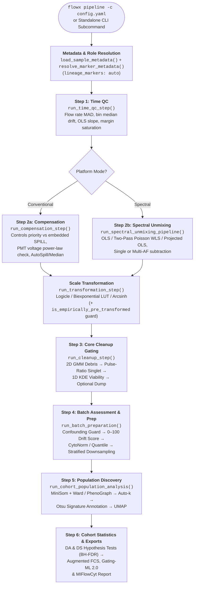

# Explanation: Unified Step Architecture & Orchestration

FlowX is architected around a **Unified Step Runner** design: every analytical stage—from Time QC and spectral unmixing through cohort statistical testing—is encapsulated in a standalone, deterministic step runner paired with typed Config and Result dataclasses. Both the end-to-end `FlowCytometryPipeline` orchestrator and the 15 standalone `flowx` CLI subcommands invoke the exact same step runners.

---

## End-to-End Pipeline Orchestration Flowchart

---

## Why Unified Step Runners?

1. **Zero CLI-vs-Pipeline Drift:** Previously, standalone subcommands could diverge from the full pipeline in default parameters, plot styling, or table schemas. By routing `flowx time-qc`, `flowx compensate`, `flowx unmix`, `flowx transform`, `flowx cleanup`, `flowx batch-prepare`, and `flowx cohort` directly into the shared step runners (`run_time_qc_step`, `run_compensation_step`, `run_spectral_unmixing_pipeline`, `run_transformation_step`, `run_cleanup_step`, `run_batch_preparation`, and `run_cohort_population_analysis`), standalone runs and `flowx pipeline` produce identical outputs and directory layouts (`01_time_qc/` through `06_statistical_analysis/` and `exports/`).
2. **Typed Contracts (`Config` $\to$ `Result`):** Each runner accepts a structured configuration dataclass (`TimeQCConfig`, `CompensationConfig`, `UnmixingConfig`, `TransformConfig`, `CleanUpGateConfig`, `BatchPreparationConfig`) built by `PipelineConfig.to_<step>_config()` and returns a structured result dataclass (`TimeQCStepResult`, `CompensationStepResult`, `UnmixingResult`, `TransformStepResult`, `CleanupStepResult`, `CohortBatchResult`, `CohortPopulationResult`).
3. **Config Auditability (`resolved_config.yaml`):** Whenever `lineage_markers: auto` or metadata auto-discovery runs, FlowX serializes the exact resolved channel lists, gating modes, and looseness values into `resolved_config.yaml` alongside the original `config.yaml`.

---

## Granularity Routing in Cohort Discovery & Statistics

During Step 5 and Step 6, `stats_granularity` controls whether hypothesis tests and exports operate on:
- **`populations` (Default):** Merged biological lineages (e.g., `CD4+ Naive T Cells`, `Classical Monocytes (CD14+ CD16-)`) written to `06_statistical_analysis/{tables,plots}/`.
- **`clusters`:** Raw unsupervised SOM metaclusters or PhenoGraph communities ($C_0 \dots C_{k-1}$) written to `06_statistical_analysis/{tables,plots}/`.
- **`both`:** Biological populations in `06_statistical_analysis/{tables,plots}/` **and** raw clusters isolated in `06_statistical_analysis/{tables,plots}/clusters/`.

---

## References & Scientific Standards

* **FlowKit Framework:** 
* **MIFlowCyt Standard:** 
* **Gating-ML 2.0 Standard:** 
