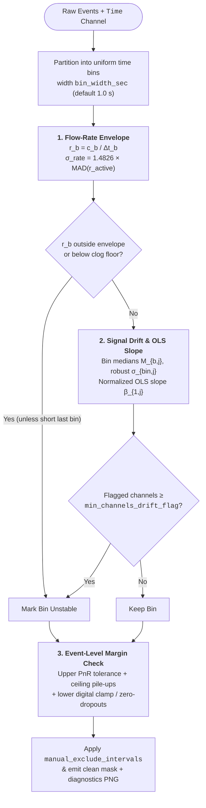

# Explanation: Time QC Mathematics

Fluidic clogs, air bubbles, laser warm-up drifts, and detector saturation corrupt downstream gating and clustering if left unremoved. FlowX's Time QC engine (`src/flowx/qc/automated.py`, `src/flowx/qc/engine.py`, `src/flowx/qc/manual.py`) partitions each acquisition along the `Time` channel into uniform temporal bins and evaluates **flow-rate stability**, **bin-median signal drift**, and **event-level margin saturation**.

---

## Time QC Decision Flowchart

---

## 1. Flow-Rate Stability Envelope

Events are binned by timestamp into bins $b = 1, \dots, B$ of duration $\Delta t_b$ (nominally `bin_width_sec`), containing $c_b$ events each. The instantaneous event rate in bin $b$ is:

$$r_b = \frac{c_b}{\Delta t_b}$$

Across active bins ($c_b > 0$), FlowX estimates the baseline center $\mu_r = \text{median}(r_{\text{active}})$ and robust scale via the normalized Median Absolute Deviation:

$$\sigma_{\text{rate}} = 1.4826 \times \text{MAD}(r_{\text{active}})$$

A bin $b$ is flagged as a flow-rate anomaly if any of the following hold:
1. **Low-rate drop:** $r_b < \max(\text{eff\_min},\; \mu_r - k_{\text{rate}} \sigma_{\text{rate}})$
2. **High-rate surge:** $r_b > \mu_r + k_{\text{rate}} \sigma_{\text{rate}}$
3. **Hard clog floor:** $r_b < \max(1.0,\; 0.15\,\mu_r)$ when $\mu_r > 10.0$ (or $r_b < 0.5$ when $\mu_r \le 10.0$)

**Short Terminal Bin Exemption:** The final bin $B$ is exempt from low-rate flagging when $\Delta t_B < 0.2\,\Delta t_{\text{bin}}$, preventing false drops caused by acquisition stop mid-bin.

---

## 2. Bin-Median Signal Drift & Linear Slope

For each fluorescence/scatter parameter $j$ and stable-rate bin $b$, FlowX computes the bin median $M_{b,j} = \text{median}_{i \in b}(x_{i,j})$ and a floored robust bin scale:

$$\sigma_{\text{bin},j} = \max\Big(1.4826 \cdot \text{MAD}(M_j),\; 0.20 \cdot \sigma_{\text{base},j},\; 0.05 \cdot \max\big(1,\, |\text{median}(M_j)|\big)\Big)$$

where $\sigma_{\text{base},j}$ is the event-level robust SD of channel $j$. A bin $b$ deviates on channel $j$ if:

$$\frac{|M_{b,j} - \text{median}(M_j)|}{\sigma_{\text{bin},j}} > k_{\text{drift}}$$

In addition, FlowX fits an ordinary least-squares linear trend across normalized time $t_b \in [0, 1]$; when the slope exceeds $|\hat{\beta}_{1,j}| > \max(0.20,\; \tau_{\text{slope}})$, bins diverging by $> 2.5\,\sigma_{\text{bin},j}$ are flagged as monotonic drift:

$$|\hat{\beta}_{1,j}| > \max(0.20,\; \tau_{\text{slope}}) \quad \land \quad z_{b,j} > 2.5$$

A bin or run triggers signal-drift exclusion only when at least `min_channels_drift_flag` channels fail concurrently, protecting against true biological subpopulation bursts in a single marker.

---

## 3. Event-Level Margin Saturation & Lower Clamp

Independently of time bins, FlowX flags individual events that hit hardware detector limits (`PnR` effective range):
- **Upper Range Saturation:** $x_{i,j} \ge \text{PnR}_{\text{eff},j}\,(1 - \text{tol})$ (default $\text{tol} = 0.001$).
- **Empirical Ceiling Pile-Ups:** Channels with $\ge 5$ events stacked identically at the empirical maximum.
- **Lower Digital Clamp / Zero-Dropouts:** Unphysical negative/zero clamp pile-ups on scatter or fluorescence channels.

---

## References & Scientific Standards

* **PeacoQC Quality Control:** 
* **flowAI Quality Control:** 
* **flowCut Quality Control:** 
