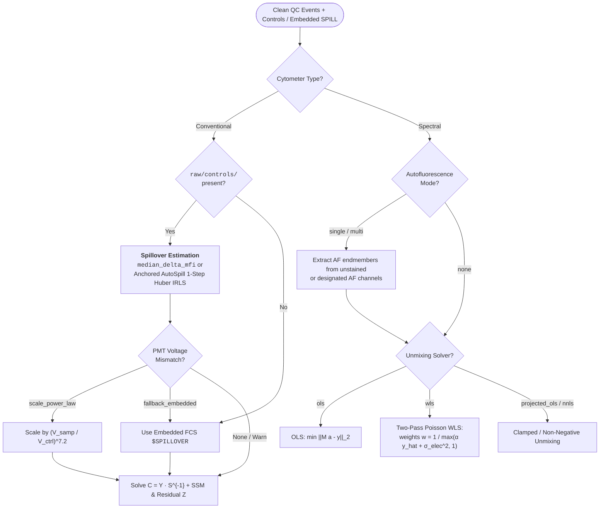

# Explanation: Compensation & Spectral Deconvolution

Optical spillover between detectors in conventional cytometry—and full-spectrum emission overlap in spectral cytometry—are both linear mixing processes: observed detector intensities $\mathbf{y}$ equal the true fluorophore abundances $\mathbf{a}$ multiplied by a mixing/spillover matrix $\mathbf{M}$ (plus noise and autofluorescence). FlowX implements both conventional compensation (`src/flowx/math/compensation.py`) and spectral unmixing (`src/flowx/spectral/unmixing.py`, `autofluorescence.py`, `metrics.py`).

---

## Conventional vs. Spectral Deconvolution Flowchart

---

## 1. Conventional Spillover Estimation

### Median $\Delta\text{MFI}$
Given gated positive ($P_i^+$) and negative ($P_i^-$) populations in single-stained control $i$:

$$S_{i,j} = \max\left(0,\; \frac{\text{Med}_j(P_i^+) - \text{Med}_j(P_i^-)}{\text{Med}_i(P_i^+) - \text{Med}_i(P_i^-)}\right)$$

### Anchored AutoSpill 1-Step Huber IRLS (`_estimate_autospill_row`)
When `autospill_regression` or `hybrid` is selected, FlowX trims the top $0.5\%$ highest-leverage $\Delta x$ events, computes the origin-anchored ordinary least-squares slope:

$$\hat{s}^{(0)} = \frac{\Delta x \cdot \Delta y}{\Delta x \cdot \Delta x}$$

and refines the slope with one iteratively reweighted least-squares (IRLS) pass using Huber weights:

$$w_e = \min\!\left(1,\; \frac{k_H}{|r_e|}\right), \qquad k_H = 2.5 \max\big(\text{rSD}(r),\, 1.0\big)$$

where $r_e = \Delta y_e - \hat{s}^{(0)} \Delta x_e$ are the initial residuals.

### Residual $Z$-Score, Spillover Spreading Matrix (SSM), & PMT Voltage Scaling
Post-compensation accuracy and photon-counting spread are quantified by:

$$Z_{\text{res}}(i \to j) = \frac{\text{Med}_j(C_i^+) - \text{Med}_j(C_i^-)}{\max\big(\text{rSD}_j(C_i^-),\, 5.0\big)}, \qquad SSM_{i,j} = \frac{\sqrt{\max\!\left(0,\, \text{rSD}_j(C_i^+)^2 - \text{rSD}_j(C_i^-)^2\right)}}{\sqrt{\Delta F_i}}$$

When control and sample PMT voltages differ (`adjust_spillover_by_pmt_voltages`), FlowX scales spillover coefficients using the empirical dynode gain power law ($\gamma = 7.2$):

$$S^{\text{scaled}}_{i,j} = S_{i,j} \left(\frac{V_{\text{samp},j}}{V_{\text{ctrl},j}}\right)^{7.2} \left(\frac{V_{\text{ctrl},i}}{V_{\text{samp},i}}\right)^{7.2}$$

---

## 2. Spectral Deconvolution & Health Metrics

Let $\mathbf{M} \in \mathbb{R}^{D \times F}$ be the normalized spectral signature matrix ($D$ detectors $\times$ $F$ fluorophores + autofluorescence endmembers).

- **Ordinary Least Squares (`ols`):** Solves $\min_{\mathbf{a}} \|\mathbf{M}\mathbf{a} - \mathbf{y}\|_2$ via the Moore-Penrose pseudoinverse $\mathbf{U} = (\mathbf{M}^T \mathbf{M})^{-1} \mathbf{M}^T$.
- **Two-Pass Poisson Weighted Least Squares (`wls`):** First computes $\hat{\mathbf{y}} = \max(\mathbf{A}_{\text{OLS}} \mathbf{M}^T, 0)$, constructs per-event, per-detector inverse-variance weights:

$$w_{i,d} = \frac{1}{\max(\alpha_{\text{poisson}}\,\hat{y}_{i,d} + \sigma_{\text{elec}}^2,\; 1.0)}$$

and solves $(\mathbf{M}^T \mathbf{W}_i \mathbf{M})\mathbf{x}_i = \mathbf{M}^T \mathbf{W}_i \mathbf{y}_i$ (falling back to $10^{-7}\mathbf{I}$ Tikhonov ridge regularization if ill-conditioned).
- **Projected OLS / NNLS (`projected_ols`, `nnls`):** Clamps OLS abundances below `negative_slack_floor` or enforces strict non-negativity.

### Spectral Panel Diagnostics
FlowX evaluates unmixing stability using:
- **Pairwise Cosine Similarity:** $\cos(\theta_{f,g}) = \dfrac{\mathbf{m}_f \cdot \mathbf{m}_g}{\|\mathbf{m}_f\|_2 \|\mathbf{m}_g\|_2}$
- **Panel Complexity Index (PCI) & Condition Number:** $\text{PCI} = \operatorname{Tr}\!\left((\mathbf{M}^T \mathbf{M})^{-1}\right)$ and $\kappa(\mathbf{M}) = \dfrac{\sigma_{\max}(\mathbf{M})}{\sigma_{\min}(\mathbf{M})}$
- **Analytical Spectral SSM:** $SSM_{i,j} = \sqrt{\alpha \sum_{d=1}^D U_{j,d}^2\, M_{d,i}}$

---

## References & Scientific Standards

* **AutoSpill Algorithm:** 
* **Spillover Spreading Matrix (SSM):** 
* **Spectral Unmixing & Autofluorescence:** 
