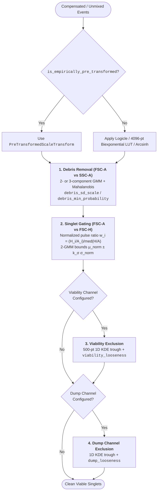

# Explanation: Scale Transformation & Cleanup Gating Math

Linear fluorescence intensities span five orders of magnitude with negative values near zero caused by compensation or unmixing noise. Before gating, clustering, or batch normalization, FlowX compresses this dynamic range (`src/flowx/math/transforms.py`) and isolates intact, single, viable target cells (`src/flowx/gating/cleanup.py`, `gate.py`, `density_gating.py`).

---

## Cleanup Gating Cascade Flowchart

---

## 1. Scale Transformations & Pre-Transformed Guard

FlowX supports three primary transformations:
- **Gating-ML 2.0 Logicle:** Evaluates `flowutils.transforms.logicle` parameterized by top-of-scale $T$, width $W$, decades $M$, and additional negative decades $A$.
- **FlowJo Biexponential LUT:** Solves $f(x) = a e^{bx} - c e^{-dx} + f_0$ via `_log_root` Newton-bisection over a 4096-point lookup table (`scipy.interpolate.interp1d`).
- **Arcsinh:** $y = \operatorname{asinh}(x / c)$ with configurable cofactor $c$ (commonly $150$–$500$ for conventional, $2000$–$6000$ for Cytek Aurora spectral) and optional `[0, 1]` rescaling.

**Pre-Transformed Safety Guard:** When `is_empirically_pre_transformed` detects $0.1 < P_{99.9}(|x|) \le 25.0$ and $\text{span} \le 30.0$, FlowX prevents double-compression by wrapping channels in `PreTransformedScaleTransform`.

---

## 2. GMM Debris Gate & Looseness Math

In `GMMClusterGate.apply` on (`FSC-A`, `SSC-A`), a 2- or 3-component Gaussian Mixture Model partitions sub-cellular debris from intact leukocytes ($\mathcal{K}_{\text{intact}}$):
- **Posterior Probability Mode (`debris_min_probability`):** Retains events satisfying:

$$\sum_{k \in \mathcal{K}_{\text{intact}}} P(k \mid \mathbf{x}_i) \ge p_{\min}$$

- **Mahalanobis Distance Scaling (`debris_sd_scale` $\ne 1.0$):** Evaluates the minimum squared Mahalanobis distance to intact centroids:

$$d_{\min}^2(\mathbf{x}_i) = \min_{k \in \mathcal{K}_{\text{intact}}} (\mathbf{x}_i - \boldsymbol{\mu}_k)^T \Sigma_k^{-1} (\mathbf{x}_i - \boldsymbol{\mu}_k) \le (2.5 \cdot s_{\text{sd}})^2$$

which is **unioned** with MAP assignment when $s_{\text{sd}} > 1.0$ (expanding the gate for fragile/large cells) and **intersected** when $s_{\text{sd}} < 1.0$ (tightening the gate). All intact events are additionally filtered by `~is_sat & ~is_noise`.

---

## 3. Pulse-Ratio Singlet Gate (`build_singlet_gate`)

To remove doublets and aggregates without arbitrary fixed-angle polygons, FlowX normalizes the pulse height-to-area ratio:

$$w_i = \frac{H_i / A_i}{\operatorname{median}(H / A)}$$

A 2-component 1D GMM is fit to $w_i$, selecting the component nearest $1.0$ with clamped standard deviation $\sigma_{\text{norm}} \in [0.020, 0.20]$. With tolerance $\tau$ (`singlet_tolerance`, default $0.25$), the multiplier is $k_\sigma = 2.5\,(\tau / 0.25)$ and events are retained inside:

$$w_i \in \big[\mu_{\text{norm}} - k_\sigma \sigma_{\text{norm}},\;\; \mu_{\text{norm}} + k_\sigma \sigma_{\text{norm}}\big]$$

---

## 4. Viability & Dump 1D KDE Trough + Looseness

For viability and dump exclusion dyes, FlowX computes a 500-point 1D Gaussian KDE (`bw=0.08`):
- **Bimodal distribution:** Locates the inter-peak valley $v$ and shifts the upper acceptance cutoff using looseness $L$ and the left-peak robust SD:

$$c = v + (L - 1.0) \cdot 1.5 \cdot \text{rSD}_{\text{left}}$$

- **Unimodal viable distribution** (e.g., fresh samples with negligible dead-cell peak): Places the cutoff relative to the primary live mode:

$$c = \text{mode} + 4.5 \cdot L \cdot \text{rSD}_{\text{left}}$$

---

## References & Scientific Standards

* **Gating-ML 2.0 Standard:** 
* **Logicle Display Method:** 
* **FlowKit Framework:** 
