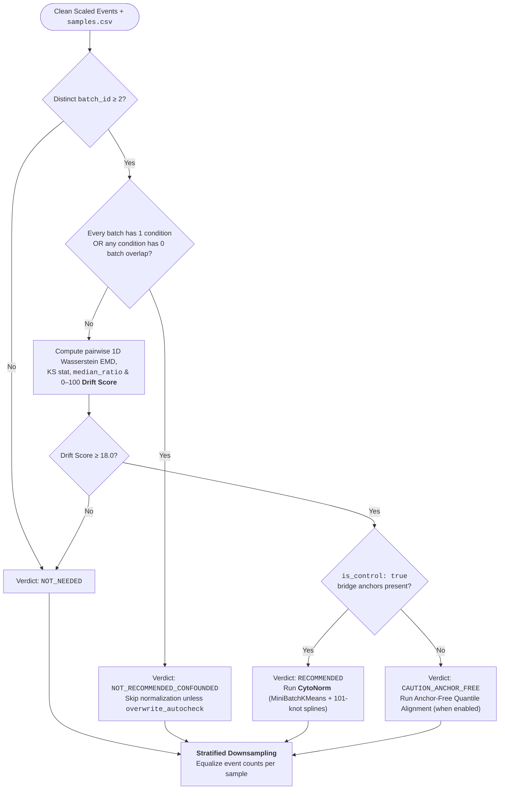

# Explanation: Batch Effect Assessment & Normalization Math

Aggressive batch normalization on confounded cohorts—or on single-batch datasets with negligible drift—can erase real biological differences between disease and control groups. FlowX protects against over-correction through a two-stage design (`src/flowx/batch/assessment.py`, `normalization.py`, `downsampling.py`): an automated **Confounding & Drift Necessity Assessor**, followed by clean-room **CytoNorm** or **Quantile Spline Alignment** and **Stratified Downsampling**.

---

## Batch Safety Guard & Normalization Flowchart

---

## 1. Confounding Guard & 0–100 Drift Score

`assess_batch_effect_need()` evaluates two structural invariants before computing any distribution shifts:
1. **Confounding Guard (`NOT_RECOMMENDED_CONFOUNDED`):** Triggered if every `batch_id` contains only a single `condition`, OR if any `condition` has zero `batch_id` overlap with all other conditions.
2. **Per-Marker Drift Metrics:** Across shared batch-comparable samples, FlowX computes pairwise 1D Wasserstein Earth Mover's Distance ($W_1$), Kolmogorov-Smirnov statistic ($\text{KS}$), normalized relative EMD ($\text{rel\_emd} = \overline{\text{EMD}} / \text{SD}_{\text{pooled}}$), and $\text{median\_ratio} = \max(\text{med}) / \min(\text{med})$. A marker is flagged as drifting when:

$$\text{is\_drifting} = (\text{rel\_emd} \ge 0.20) \;\lor\; (\text{median\_ratio} \ge 1.30)$$

Let $f_{\text{drift}}$ be the fraction of drifting markers. The composite **Drift Score** ($[0, 100]$) is:

$$\text{DriftScore} = \min\!\left(100,\;\; 50\,f_{\text{drift}} + 30 \min\!\left(\frac{\overline{\text{rel\_EMD}}}{0.50},\, 1\right) + 20 \min\!\left(\frac{\overline{\text{KS}}}{0.25},\, 1\right)\right)$$

Normalization is skipped automatically (`NOT_NEEDED`) whenever $\text{DriftScore} < 18.0$.

---

## 2. Clean-Room CytoNorm & Quantile Spline Mapping

When batch normalization runs:
1. **Cell-Subset Stratification (`MiniBatchKMeans`):** `CytoNormModel` clusters pooled `is_control: true` bridge anchors (or all cells in anchor-free mode) into $K$ coarse metaclusters so quantile shifts are learned *within* matched cell states rather than distorting composition differences.
2. **101-Knot Quantile Splines (`QuantileSplineMapping`):** For each batch $b$, cluster $k$, and marker $m$, FlowX computes $Q = 101$ quantile knots ($0\%, 1\%, \dots, 100\%$) and maps them monotonically to the `median`, `mean`, or `reference` goal quantiles via piecewise linear interpolation with linear tail extrapolation outside $[q_0, q_{100}]$.

---

## References & Scientific Standards

* **CytoNorm Batch Normalization:** 
* **MIFlowCyt Standard:** 
