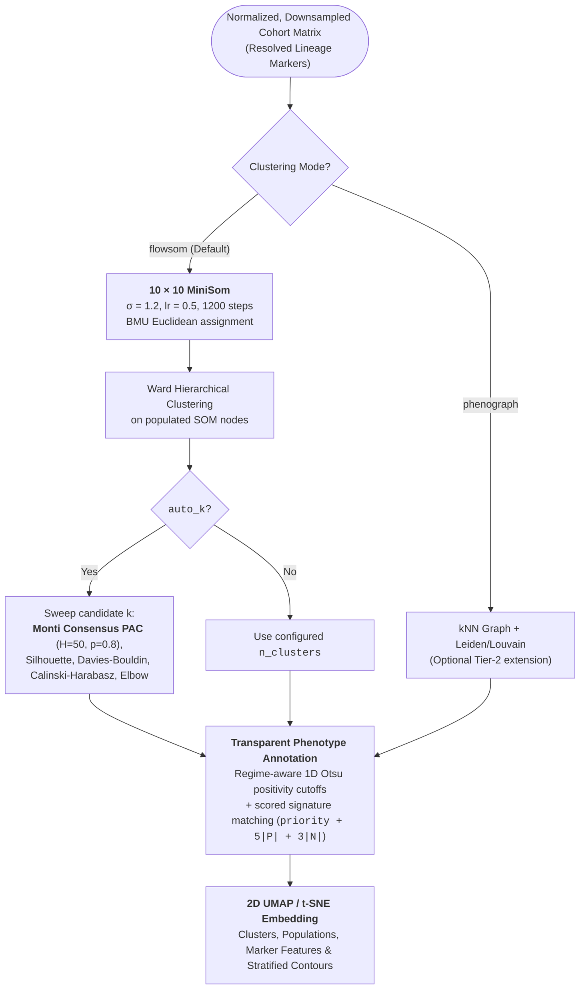

# Explanation: Clustering, Manifolds & Annotation Math

To discover canonical and novel leukocyte subsets reproducibly without GPL dependencies, FlowX pairs a permissive **MiniSom + Ward Metaclustering** engine (`src/flowx/clustering/cluster.py`) with **UMAP / t-SNE** manifold projections (`src/flowx/clustering/reduction.py`) and **Otsu-Thresholded Signature Annotation**.

---

## Population Discovery & Annotation Flowchart

---

## 1. MiniSom & Populated-Node Ward Metaclustering

1. **Self-Organizing Map (SOM):** A $10 \times 10$ hexagonal/rectangular neural lattice ($\sigma = 1.2$, initial learning rate $\text{lr} = 0.5$, $1200$ training iterations) maps standardized lineage marker vectors onto $100$ prototype nodes. Each cell is assigned to its Best Matching Unit (BMU) by Euclidean distance.
2. **Populated-Node Filtering:** Only SOM nodes with $\ge 1$ assigned cell enter Ward hierarchical linkage, preventing empty lattice nodes from distorting metacluster centroids.

---

## 2. Auto-$k$ Optimization Criteria

When `n_clusters: auto` is enabled, FlowX sweeps candidate $k \in [k_{\min}, k_{\max}]$ using the configured `auto_k_metric`:
- **`consensus` (Default, Monti PAC):** Runs $H = 50$ subsampling iterations (fraction $p = 0.8$), builds the $N_{\text{nodes}} \times N_{\text{nodes}}$ co-clustering consensus matrix $\mathcal{M}^{(k)}$, and computes the Proportion of Ambiguous Clustering:

$$\text{PAC}(k) = \operatorname{mean}\!\left(0.1 < \mathcal{M}^{(k)}_{u < v} < 0.9\right)$$

FlowX selects the largest $k$ whose $\text{PAC}(k) \le \min_{k'} \text{PAC}(k') + 0.005$, favoring biological resolution when stability ties occur.
- **`elbow`:** Maximizes the normalized secant distance from the $(k_{\text{norm}}, \text{WCSS}_{\text{norm}})$ diagonal:

$$d_{\text{elbow}}(k) = \frac{1 - (k_{\text{norm}} + w_{\text{norm}})}{\sqrt{2}}$$

- **`silhouette`, `davies_bouldin`, `calinski_harabasz`:** Standard cluster-compactness and separation indices written to `metacluster_k_metrics.csv`.

---

## 3. Regime-Aware Otsu Annotation & Signature Scoring

For each lineage marker $m$, `_otsu_1d` computes an adaptive 1D Otsu threshold separating negative vs. positive cluster MFI regimes. Each metacluster's binary/continuous expression profile is matched against declarative biological signatures $(P, N)$ (required positive markers $P$ and excluded negative markers $N$), ranked by:

$$\text{Score} = \text{priority} + 5\,|P| + 3\,|N|$$

Every assignment—including matched markers and confidence—is recorded in `cluster_annotation_audit.csv`.

---

## References & Scientific Standards

* **FlowSOM Clustering:** 
* **PhenoGraph Community Detection:** 
* **UMAP Dimensionality Reduction:** 
