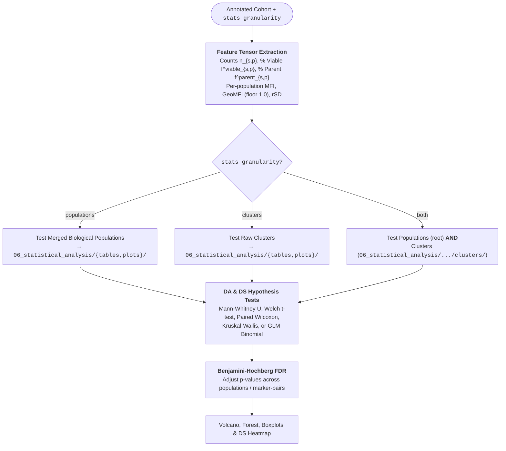

# Explanation: Statistical Testing & Power Theory

FlowX separates quantitative cohort inference (`src/flowx/stats/metrics.py`, `differential_abundance.py`, `differential_state.py`) into **Differential Abundance (DA)**—changes in population frequencies across conditions—and **Differential State (DS)**—changes in functional marker expression *within* a defined population.

---

## Cohort Feature Extraction & Hypothesis Testing Flowchart

---

## 1. Per-Population Summary Metrics

For sample $s$, population $p$, and marker intensities $\{x_i\}_{i=1}^n$:
- **Geometric Mean (`geometric_mean`):** Clipped at a positive pseudocount floor of $1.0$ to remain well-defined near zero:

$$\text{GeoMFI} = \exp\!\left(\frac{1}{n}\sum_{i=1}^n \ln \max(x_i,\, 1.0)\right)$$

- **Robust Standard Deviation (`robust_sd`):** Estimated via $1.4826 \times \text{MAD}(x)$ (with IQR fallback $(Q_{75} - Q_{25}) / 1.349$).
- **Effect Sizes:** $\log_2$ fold-change with continuity offset $0.01$ and Cohen's $d$:

$$\log_2 \text{FC} = \log_2\!\left(\frac{\bar{f}_{\text{target}} + 0.01}{\bar{f}_{\text{ref}} + 0.01}\right)$$

---

## 2. The Combinatoric Power Floor in Small Cohorts

By default, FlowX uses the non-parametric two-sided **Mann-Whitney $U$** test for two-group comparisons. Because Mann-Whitney operates strictly on sample ranks, its minimum achievable two-sided $p$-value is bounded combinatorially by group sizes $(n_{\text{ref}}, n_{\text{target}})$:

$$p_{\min} = \frac{2}{\binom{n_{\text{ref}} + n_{\text{target}}}{n_{\text{ref}}}}$$

| Group Sizes $(n_{\text{ref}}, n_{\text{target}})$ | Exact $p_{\min}$ | Can $p < 0.05$ Ever Occur? |
| :---: | :---: | :---: |
| $(2, 2)$ | $2 / \binom{4}{2} = 0.3333$ | **No** |
| $(3, 3)$ | $2 / \binom{6}{3} = 0.1000$ | **No** |
| $(4, 4)$ | $2 / \binom{8}{4} = 0.0286$ | **Yes** |
| $(5, 3)$ | $2 / \binom{8}{3} = 0.0357$ | **Yes** |

Thus, two-sided rank-sum significance at $\alpha = 0.05$ **mathematically requires $n \ge 4$ per group** (or $(5, 3)$ as observed in `kreutmair_2026_icu_pbmc`, $p = 0.0357$, and $(4, 4)$ in `quintelier_2023_cytonorm_meso`, $p = 0.0286$). For pilot cohorts with $n \le 3$, use `da_test_method: t_test` (`welch_ttest`) or `glm_binomial` (pooled two-proportion $Z$-test across cell counts).

---

## 3. Multiple Testing Correction (Benjamini-Hochberg FDR)

Raw $p$-values across $m$ hypotheses (populations in DA; population $\times$ functional-marker pairs in DS) are sorted $p_{(1)} \le \dots \le p_{(m)}$ and adjusted via step-up Benjamini-Hochberg (`fdr_correction`):

$$q_{(i)} = \min_{k \ge i}\left(\min\!\left(1,\; \frac{m}{k}\, p_{(k)}\right)\right)$$

---

## References & Scientific Standards

* **Benjamini-Hochberg FDR Control:** 
* **diffcyt DA/DS Framework:** 
* **MIFlowCyt Standard:** 
