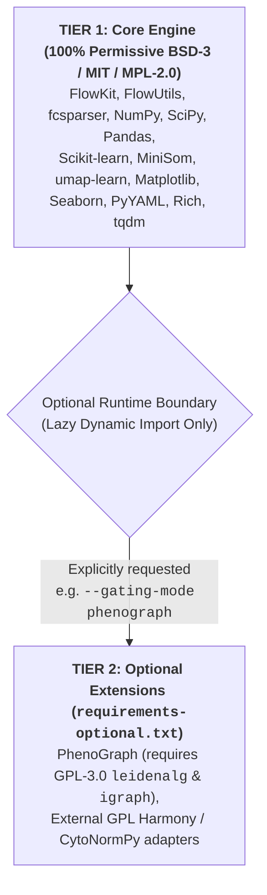

# Explanation: Licensing & Clean-Room Governance

FlowX is distributed under the **Business Source License 1.1** (`LICENSE.txt`, converting to **MPL-2.0** on `2030-11-17`), with free production use for non-commercial academic, educational, and non-profit scientific research and commercial licenses available for industry. Architecturally, FlowX enforces a strict boundary between a **100% Permissive Core Dependency Tree** (BSD-3-Clause / MIT / PSF / MPL-2.0 only) and **Isolated Optional Research Extensions**, ensuring both open academic reproducibility and clean-room IP hygiene without viral GPL copyleft contamination.

---

## Two-Tier Licensing & Isolation Architecture

---

## 1. Copyleft Contamination Defenses & Clean-Room Replacements

In computational cytometry, several widely used tools (`CytoNorm` in R, `CytoNormPy`, `harmonypy`, `pyComBat`, and `PhenoGraph`'s `leidenalg`/`igraph` backend) are distributed under **GPL-2.0 / GPL-3.0**. Hard-importing a GPL package in Python triggers viral copyleft obligations across the entire application.

FlowX eliminates copyleft contamination in its core engine through **clean-room algorithmic re-implementation**:
1. **CytoNorm Batch Normalization:** Re-implemented natively in `flowx.batch.normalization` from the peer-reviewed mathematical formulation (MiniBatchKMeans + 101-knot quantile spline alignment) using `numpy`, `scipy`, and `scikit-learn`.
2. **FlowSOM Clustering:** Re-implemented natively in `flowx.clustering.cluster` using permissive `MiniSom` (MIT) and `scikit-learn` (BSD-3-Clause) Ward linkage.
3. **AutoSpill & Compensation:** Implemented natively in `flowx.math.compensation` using vectorized `numpy` OLS and 1-step Huber IRLS.
4. **Tier-2 Lazy Isolation:** No module in `src/flowx/` may top-level-import an optional GPL-dependent library. Optional extensions such as `phenograph` are loaded inside local function scopes only when explicitly requested by the user, raising a clear `ImportError` pointing to `requirements-optional.txt` otherwise.

---

## 2. Core Permissive Dependency Matrix

| Package | License | SPDX Identifier | Role in FlowX |
| :--- | :--- | :--- | :--- |
| **FlowKit** | BSD 3-Clause | `BSD-3-Clause` | FCS parsing, Gating-ML 2.0 & workspace I/O |
| **FlowUtils** | BSD 3-Clause | `BSD-3-Clause` | Logicle & biexponential C-extensions |
| **fcsparser** | MIT | `MIT` | Lightweight fallback FCS reader |
| **NumPy / SciPy / Pandas** | BSD 3-Clause | `BSD-3-Clause` | Vectorized arrays, splines, KDE, cohort tables |
| **Scikit-learn** | BSD 3-Clause | `BSD-3-Clause` | GMMs, nearest neighbors, MiniBatchKMeans |
| **MiniSom** | MIT | `MIT` | Self-Organizing Map neural lattice |
| **umap-learn** | BSD 3-Clause | `BSD-3-Clause` | UMAP dimensionality reduction & manifold embeddings |
| **Matplotlib / Seaborn** | PSF / BSD-3 | `PSF-2.0` / `BSD-3-Clause` | Publication-grade static visualizations |
| **PyYAML / Rich / pytest** | MIT | `MIT` | Config parsing, terminal UI, test suite |
| **tqdm** | MPL-2.0 / MIT | `MPL-2.0 AND MIT` | Progress bars for batch QC and gating runners |

---

## References & Scientific Standards

* **MIFlowCyt Standard:** 
* **CytoNorm Batch Normalization:** 
* **AutoSpill Algorithm:** 
* **FlowSOM Clustering:** 
* **UMAP Dimensionality Reduction:** 
