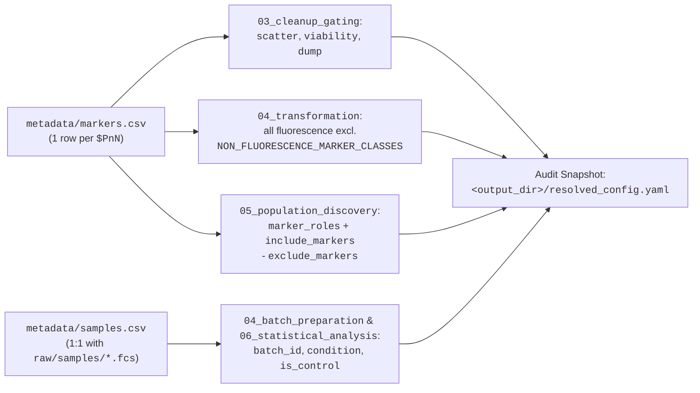

# 01. Curate Cohort Metadata & `"auto"` Role Resolution

Use `metadata/samples.csv` and `metadata/markers.csv` so your YAML configurations can declare `"auto"` instead of hardcoding 20–40 detector channel names per study.

---

## Decision Flow: How FlowX Resolves `"auto"` Roles



---

## 1. Curate `metadata/samples.csv` (Cohort Design)

Place `samples.csv` at `data/<platform>/<dataset_name>/metadata/samples.csv`. FlowX discovers it automatically via `load_sample_metadata()` inside `FlowCytometryPipeline` and `run_cohort_population_analysis()`.

**Required columns:**
- `sample_id`: Exact `.fcs` filename stem without extension (1:1 with `raw/samples/`).
- `filename`: Exact FCS filename (`<stem>.fcs`).
- `relative_path`: Relative path from dataset root (`raw/samples/<file>.fcs`).
- `condition`: Verified biological group (e.g., `Healthy_Control`, `ALS_Patient`).
- `batch_id`: Acquisition batch derived from FCS `$DATE` and `$CYT` (`YYYY-MM-DD_<Cytometer>`).
- `is_control`: Lowercase boolean (`true` or `false`) marking CytoNorm bridge controls (**never** place single-stain compensation bead tubes in `samples.csv`).
- `provenance_source`: Explicit source (`FCS $TEXT`, `DOI:...`).

---

## 2. Curate `metadata/markers.csv` (Panel & Roles)

Place `markers.csv` at `data/<platform>/<dataset_name>/metadata/markers.csv` with **1 row per physical `$PnN` channel**.

* **Example 1 — Whole-Blood Multi-Role Markers (`conventional/brouwers_2026_whole_blood_omip`):**
  Use semicolon-delimited (`;`) multi-roles inside `marker_class` when an antigen serves dual purposes (e.g., `HLA_DR` as `lineage;functional`, `CD14_TCRgd` as `lineage;dump`), preserving verbatim `$PnN` channel names:
  ```csv
  channel_name,marker_name,fluorophore,clone_or_catalog,marker_class,cell_type_association,provenance_source
  Blue4-710_50-A,CD14_TCRgd,PerCP-Cy5.5,Not specified in FCS or publication,lineage;dump,Monocytes; Gamma-Delta T Cells,FCS_$P9N/$P9S + OMIP_Panel_Summary.md
  Violet5-670_30-A,HLA_DR,BV650,Not specified in FCS or publication,lineage;functional,Antigen Presenting Cells (MHC-II); Activated T Cells,FCS_$P22N/$P22S + OMIP_Panel_Summary.md
  ```

* **Example 2 — Excluding Spectral Autofluorescence (`spectral/rockstein_2026_omip_whole_blood`):**
  Across the 49 channels (41 biological markers + `AF-A` + scatter/time), tag `AF-A` as `marker_class: autofluorescence` (part of `NON_FLUORESCENCE_MARKER_CLASSES`: `autofluorescence`, `index`, `qc`, `scatter`, `time`, `unused`) so it never leaks into transformation or clustering.

---

## 3. Configure `"auto"` Selectors in YAML & CLI

**YAML (`configs/config_run/...`):**
```yaml
input:
  fcs_file: data/conventional/brouwers_2026_whole_blood_omip
  metadata_file: data/conventional/brouwers_2026_whole_blood_omip/metadata/samples.csv
  markers_file: data/conventional/brouwers_2026_whole_blood_omip/metadata/markers.csv

03_cleanup_gating:
  fsc_channel: auto
  ssc_channel: auto
  viability_channel: auto
  dump_channel: auto        # Auto-enables dump_enabled=True when a 'dump' row exists

04_transformation:
  channels: auto            # Excludes scatter, time, autofluorescence, unused, index, qc

05_population_discovery:
  lineage_markers: auto
  marker_roles: ["lineage"] # Or ["lineage", "functional"]
  include_markers: ["HLA_DR"]
  exclude_markers: ["CD14_TCRgd"]
```

**CLI Equivalent (`flowx cohort` / `flowx pipeline`):**
```bash
flowx cohort data/conventional/brouwers_2026_whole_blood_omip/raw/samples/*.fcs \
  --markers-file data/conventional/brouwers_2026_whole_blood_omip/metadata/markers.csv \
  --metadata-file data/conventional/brouwers_2026_whole_blood_omip/metadata/samples.csv \
  --markers auto --marker-roles lineage,functional --include-markers HLA_DR \
  -o outputs/config_run/conventional/brouwers_2026_whole_blood_omip
```

Always inspect `<output_dir>/resolved_config.yaml` after a run to verify the exact resolved channel list.

---

## References & Scientific Standards

* **MIFlowCyt Standard:** [](doi:10.1002/cyto.a.20623)
* **FCS 3.1 Data File Standard:** [](doi:10.1002/cyto.a.20825)
