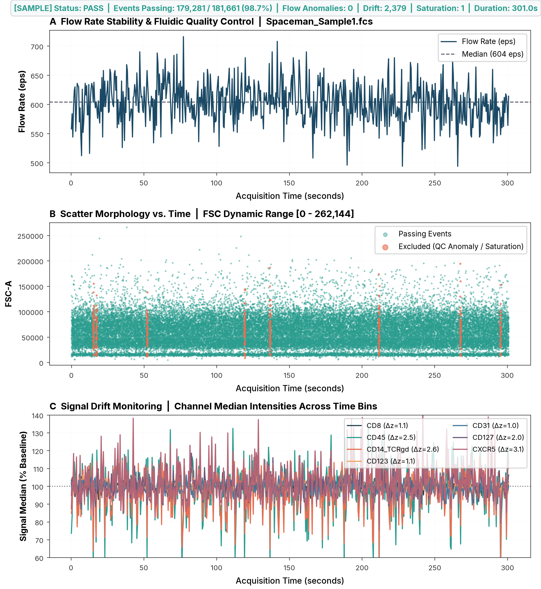
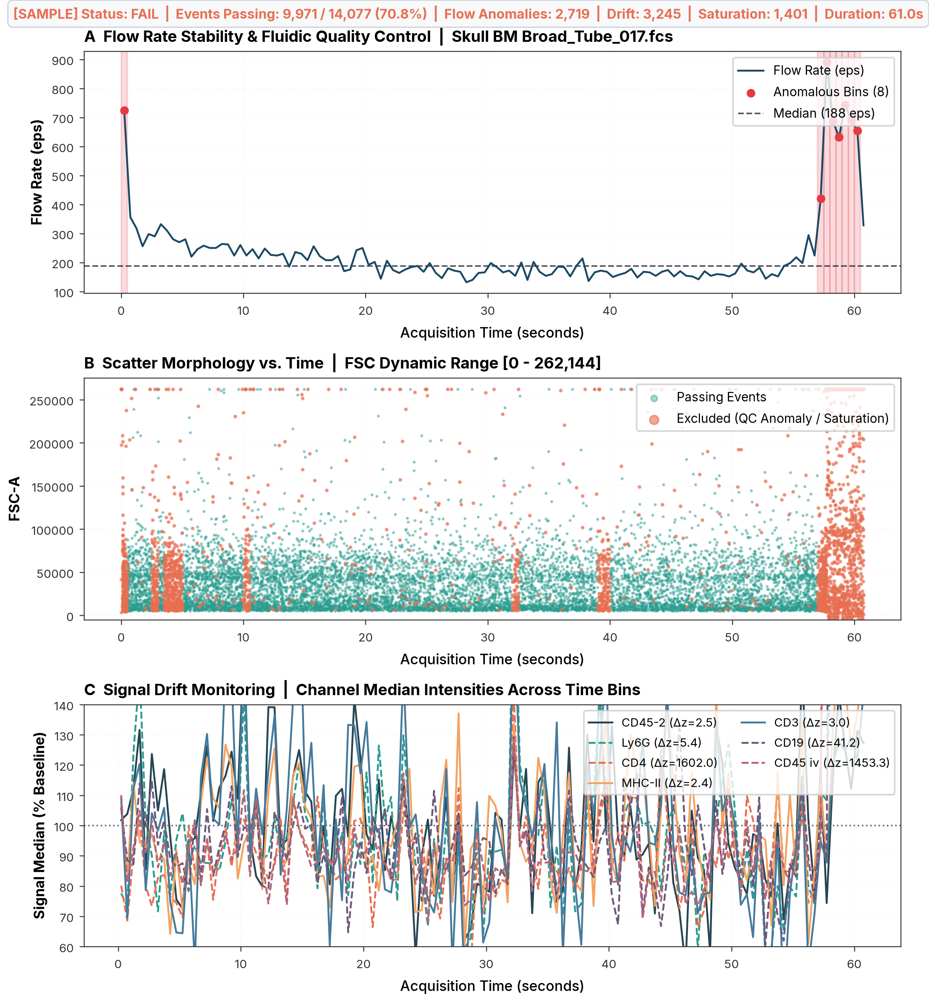

# 03. Remove Fluidic Anomalies & Salvage Short Controls (`flowx time-qc`)

Use `flowx time-qc` (alias `flowx qc`) to strip pressure surges, clogs, signal drifts, and hardware saturation spikes while rescuing short single-stain compensation controls.

---

## 1. Run Standalone Time QC with Config or CLI

**Example — 22-Color Human Whole Blood (`conventional/brouwers_2026_whole_blood_omip`):**

```bash
# Config-driven Time QC (reads input, 01_time_qc, and output sections)
flowx time-qc -c configs/config_run/conventional/brouwers_2026_whole_blood_omip.yaml

# Standalone CLI with custom bin width and clean FCS export
flowx qc data/conventional/brouwers_2026_whole_blood_omip/raw/samples \
  --bin-width 0.5 \
  --min-sample-events 5000 \
  --export-clean-fcs \
  -o outputs/time_qc/brouwers
```



---

## 2. Salvage Short Compensation Controls (`quintana_2026_skull_marrow_chimera` Complement)

Single-stain compensation bead tubes often acquire for only 5–15 seconds and have lower event counts than biological samples. FlowX applies `TimeQCConfig.for_controls()` automatically when files are detected as controls:
- Narrower `bin_width_sec = 0.25s`
- Relaxed `flow_rate_mad_factor = 4.5` and `flow_rate_min_eps = 20.0`
- `enable_signal_drift = False` (avoids rejecting bright single-positive bead peaks)
- Lower minimum retention threshold (`--min-control-events 500`)

```bash
flowx time-qc data/conventional/quintana_2026_skull_marrow_chimera/raw/controls \
  --min-control-events 500 \
  -o outputs/time_qc/quintana_controls
```



---

## 3. Configure Manual Time Windows in YAML

When a known clog or bubble appears at a fixed timestamp (e.g., excluding `[12.0, 18.5]` seconds):

```yaml
01_time_qc:
  enabled: true
  bin_width_sec: 0.5
  enable_signal_drift: true
  trim_margins: true
  manual_exclude_intervals:
    - [12.0, 18.5]
  pass_threshold_pct: 90.0
  warn_threshold_pct: 75.0
```
For event-count floors during standalone batch QC, pass `--min-sample-events 5000` and `--min-control-events 500` on `flowx time-qc`.

---

## References & Scientific Standards

* **flowAI Algorithm:** [](doi:10.1093/bioinformatics/btw191)
* **flowCut Algorithm:** [](doi:10.1002/cyto.a.24670)
* **PeacoQC Algorithm:** [](doi:10.1002/cyto.a.24501)
