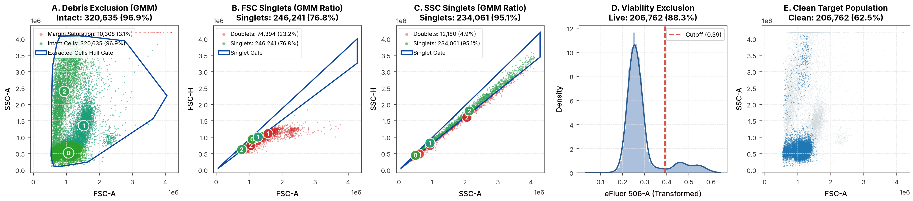
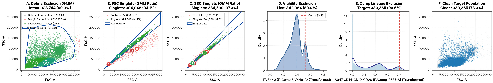

# 06. Tune Cleanup Gate Boundary Looseness (`flowx cleanup`)

Default FlowX cleanup gates (`1.0` / `0.25` / `None`) enforce strict automated boundaries. For fragile, cryopreserved clinical PBMCs, large blasts, or heterogeneous primary tissues, tune the 5 boundary looseness controls to prevent over-trimming viable target cells.

---

## 1. Looseness Parameter Reference

| Cleanup Stage | Parameter (Default) | Mechanism & Recommended Loose Values |
| :--- | :--- | :--- |
| **1. Debris Removal (`Cells`)** | `debris_sd_scale` (`1.0`)<br>`debris_min_probability` (`null`)<br>`debris_n_components` (`3`) | • **`debris_sd_scale > 1.0`** (e.g., `1.25`–`1.6`): rescues edge events within $d_{\min}^2 \le (2.5 \cdot s_{\text{sd}})^2$ Mahalanobis distance of intact clusters (`< 1.0` tightens).<br>• **`debris_min_probability`** (e.g., `0.15`–`0.30`): keeps marginal events with summed intact-cell posterior $\sum P(k \mid x) \ge p_{\min}$.<br>• Use `debris_n_components: 2` for homogeneous cell lines; `3` for whole blood / PBMCs. |
| **2. Singlet Gating (`Singlets_*`)** | `singlet_tolerance` (`0.25`)<br>`singlet_mode` (`dual`) | • **Increase `singlet_tolerance`** (e.g., `0.32`–`0.45`): widens $k_\sigma = 2.5 \cdot (\text{tol} / 0.25)$ in `gmm_ratio` and the $\pm\text{tol}$ diagonal corridor in `envelope`.<br>• Relax `singlet_mode` from `dual` to `fsc_only` or `none` if needed. |
| **3. Viability Gating (`Viable`)** | `viability_looseness` (`1.0`) | • **`viability_looseness > 1.0`** (e.g., `1.25`–`1.5`): shifts bimodal KDE valley by $(L - 1.0) \cdot 1.5 \cdot \text{rSD}_{\text{left}}$ or scales unimodal right tail to $\text{mode} + 4.5 \cdot L \cdot \text{rSD}_{\text{left}}$. |
| **4. Dump Exclusion (`Target`)** | `dump_looseness` (`1.0`) | • **`dump_looseness > 1.0`** (e.g., `1.2`–`1.4`): shifts automated dump density valley upward conservatively. |

---

## 2. Real-World PBMC Examples (`michaelis_2025_c9orf72_als_pbmc` & `balin_2025_thymopoiesis_omip116`)

Cryopreserved clinical ALS PBMCs (`michaelis_2025_c9orf72_als_pbmc`) and 39-color PBMC/thymocyte panels (`balin_2025_thymopoiesis_omip116`) use loosened boundaries in `configs/config_run/spectral/`:

**YAML (`03_cleanup_gating`):**
```yaml
03_cleanup_gating:
  enabled: true
  debris_method: gmm
  debris_n_components: 3
  debris_sd_scale: 1.25
  debris_min_probability: null
  singlet_mode: dual
  singlet_method: gmm_ratio
  singlet_tolerance: 0.32
  enable_viability: true
  viability_channel: eFluor 506-A
  viability_looseness: 1.25
```

**Standalone CLI Equivalent:**
```bash
flowx cleanup data/spectral/michaelis_2025_c9orf72_als_pbmc/raw/samples \
  --markers-file data/spectral/michaelis_2025_c9orf72_als_pbmc/metadata/markers.csv \
  --debris-sd-scale 1.25 --singlet-tolerance 0.32 --viability-looseness 1.25 \
  -o outputs/cleanup/michaelis_loose
```





---

## 3. Simultaneous Viability + Dump Exclusion (`li_2025_caerin_macrophage_ly6c` Complement)

When excluding both dead cells (`BV510-A`) and unwanted lineages (`APC-Cy7-A` dump), set `dump_enabled: true` (or `dump_channel: auto` with a `dump` row in `markers.csv`) and tune `--dump-looseness`:

```bash
flowx cleanup -c configs/config_run/conventional/li_2025_caerin_macrophage_ly6c.yaml --dump-looseness 1.2
```

---

## References & Scientific Standards

* **openCyto Automated Gating:** [](doi:10.1371/journal.pcbi.1003806)
* **Logicle Data Scaling:** [](doi:10.1002/cyto.a.20258)
* **MIFlowCyt Standard:** [](doi:10.1002/cyto.a.20623)
