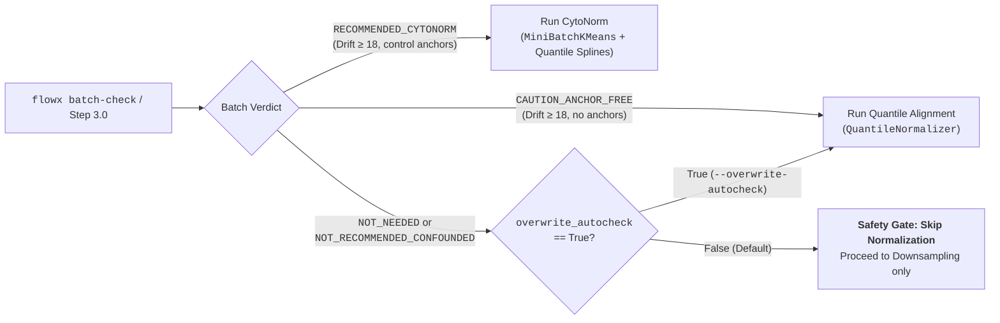
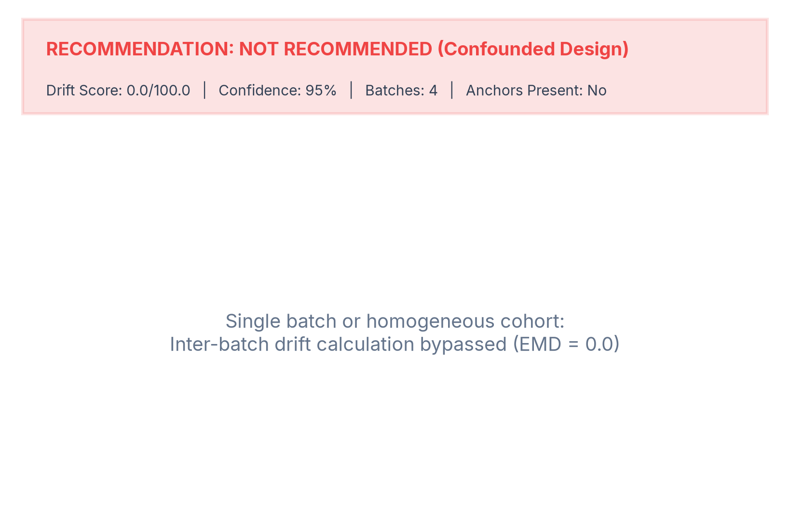

# 07. Batch Necessity Auto-Check, Confounding Guards & Normalization

FlowX runs `assess_batch_effect_need()` **by default** (`assess_batch_effect: true`) in both `flowx pipeline` and `flowx batch-prepare` to prevent normalizing single-batch cohorts or erasing true biological differences in confounded designs.

---

## 1. Decision Flow & Safety Gate (`overwrite_autocheck`)



---

## 2. Diagnose Batch Drift First (`flowx batch-check`)

```bash
flowx batch-check -c configs/config_run/spectral/kreutmair_2026_icu_pbmc.yaml
```

Emits `batch_necessity_assessment.json`, `batch_necessity_metrics.csv`, `batch_necessity_report.md`, and `batch_necessity_summary.png`.

---

## 3. PBMC Scenarios Across Real Cohorts

### Scenario A — Multi-Batch PBMC Drift Without Anchors (`kreutmair_2026_icu_pbmc`, `quintelier_2023_cytonorm_meso`, `flagr_2024_cytobatch_pbmc`)
In `kreutmair_2026_icu_pbmc` (2 ICU batches) and the 4-sample `flagr_2024_cytobatch_pbmc` subset (all `is_control: false`), `assess_batch_effect_need()` returns `CAUTION_ANCHOR_FREE` (`96.9 / 100.0` Drift Score in `kreutmair_2026_icu_pbmc`), allowing `quantile` alignment to proceed.

### Scenario B — Multi-Batch Cohorts with CytoNorm Bridge Anchors (`is_control: true`)
When identical biological bridge controls are acquired across $\ge 2$ batches, tag them with `is_control: true` in `metadata/samples.csv` (see the `is_control` control-bridge schema in `chen_2025_placenta_hspc`) and set `normalization_method: cytonorm`. Whenever `batch_count >= 2`, `has_control_anchors` is `true` across $\ge 2$ batches, and Drift Score $\ge 18.0$, FlowX returns `RECOMMENDED_CYTONORM` and runs `CytoNormModel`:

```yaml
04_batch_preparation:
  enabled: true
  assess_batch_effect: true
  overwrite_autocheck: false
  normalization_method: cytonorm
  batch_column: batch_id
  goal: median
  mode: min_sample
  target_events: 50000
```

### Scenario C — Confounded Batch Safety Guard (`michaelis_2025_c9orf72_als_pbmc`)
When `ALS_Patient` samples were acquired on `2024-05-16` and `Healthy_Control` samples on separate dates, normalizing across batches would erase disease biology. FlowX flags `NOT_RECOMMENDED_CONFOUNDED` and automatically skips normalization:



Only override this guard when explicitly testing forced alignment:
```bash
flowx batch-prepare -c configs/config_run/spectral/michaelis_2025_c9orf72_als_pbmc.yaml --overwrite-autocheck
```

---

## References & Scientific Standards

* **CytoNorm Batch Normalization:** [](doi:10.1002/cyto.a.23904)
* **MIFlowCyt Standard:** [](doi:10.1002/cyto.a.20623)
