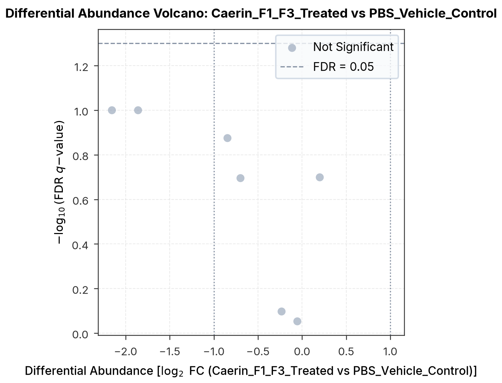
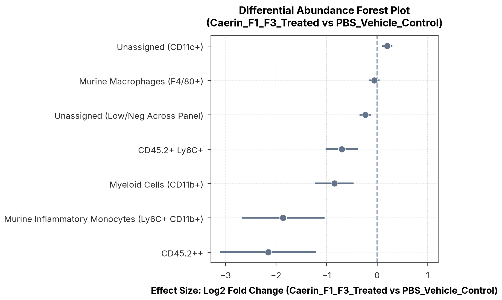
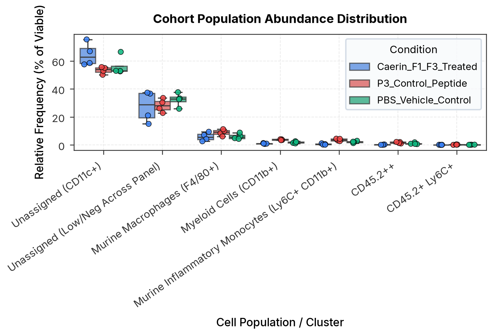

# 09. Run Cohort Differential Abundance (DA) & Differential State (DS)

Test population frequency shifts (DA) and functional marker intensity modulations (DS) across experimental conditions with multiple-testing FDR control.

---

## 1. Choose `stats_granularity` & Hypothesis Tests

**YAML (`06_statistical_analysis`):**
```yaml
06_statistical_analysis:
  enabled: true
  condition_column: condition
  reference_group: Healthy_Control
  target_group: ALS_Patient
  paired_column: null                # Set to donor/patient column for paired Wilcoxon
  da_test_method: auto               # auto | mann_whitney | t_test | welch_ttest | wilcoxon_paired | kruskal | glm_binomial
  ds_test_method: auto               # auto | mann_whitney | t_test | wilcoxon_paired
  stats_granularity: populations     # populations | clusters | both
  marker_roles: ["lineage", "functional"]
  fdr_threshold: 0.05
  log2fc_threshold: 1.0
```

When `stats_granularity: both`, FlowX outputs merged biological population stats at `06_statistical_analysis/{tables,plots}/` and isolates raw cluster-level DA/DS tables and plots under `06_statistical_analysis/{tables,plots}/clusters/`.

**Standalone CLI:**
```bash
flowx cohort -c configs/config_run/spectral/michaelis_2025_c9orf72_als_pbmc.yaml \
  --stats-granularity both --da-method mann_whitney --fdr-threshold 0.05
```

---

## 2. Understand the Mann-Whitney Sample Size Floor

For small cohorts ($n_{\text{ref}}, n_{\text{target}} \le 3$), the minimum achievable two-sided Mann-Whitney $U$ $p$-value is $p_{\min} = 2 / \binom{n_{\text{ref}} + n_{\text{target}}}{n_{\text{ref}}}$ (e.g., $p_{\min} = 0.333$ for $2$ vs $2$, $0.100$ for $3$ vs $3$).
- **PBMC cohorts with $n \ge 3$–$5$:** `michaelis_2025_c9orf72_als_pbmc` (DA & DS nominal $p = 0.0357$), `kreutmair_2026_icu_pbmc` (DS nominal $p = 0.0357$), and `quintelier_2023_cytonorm_meso` (DS nominal $p = 0.0286$) detect clear nominal shifts.
- **Complements ($n = 4$–$6$/group):** `li_2025_caerin_macrophage_ly6c` detects nominal DA ($p = 0.0286$, $q = 0.10$) and DS ($p = 0.0211$, $q = 0.10$) shifts, while `weber_2025_bk_polyomavirus` ($n \ge 5$) produces **2 FDR-significant** DS hits ($p = 0.0079$, $q = 0.0238$).







---

## References & Scientific Standards

* **diffcyt Statistical Framework:** [](doi:10.1038/s41467-019-10776-x)
* **Benjamini-Hochberg FDR:** [](doi:10.1111/j.2517-6161.1995.tb02031.x)
* **MIFlowCyt Standard:** [](doi:10.1002/cyto.a.20623)
