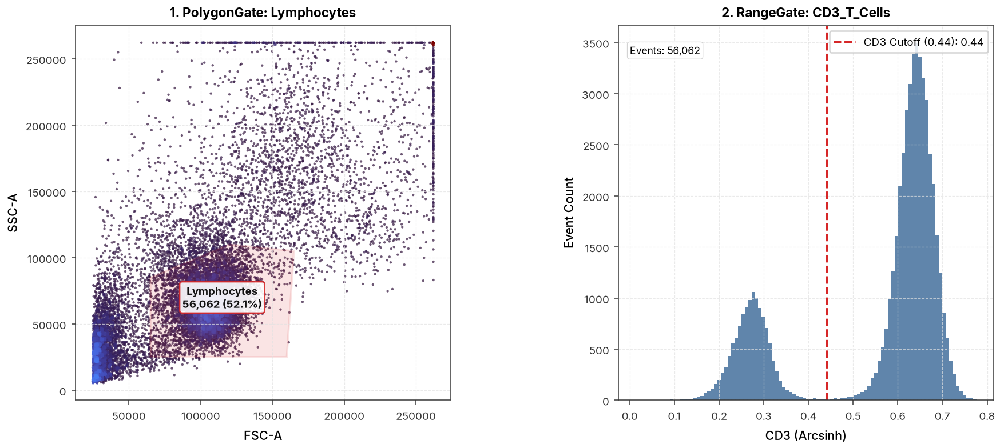
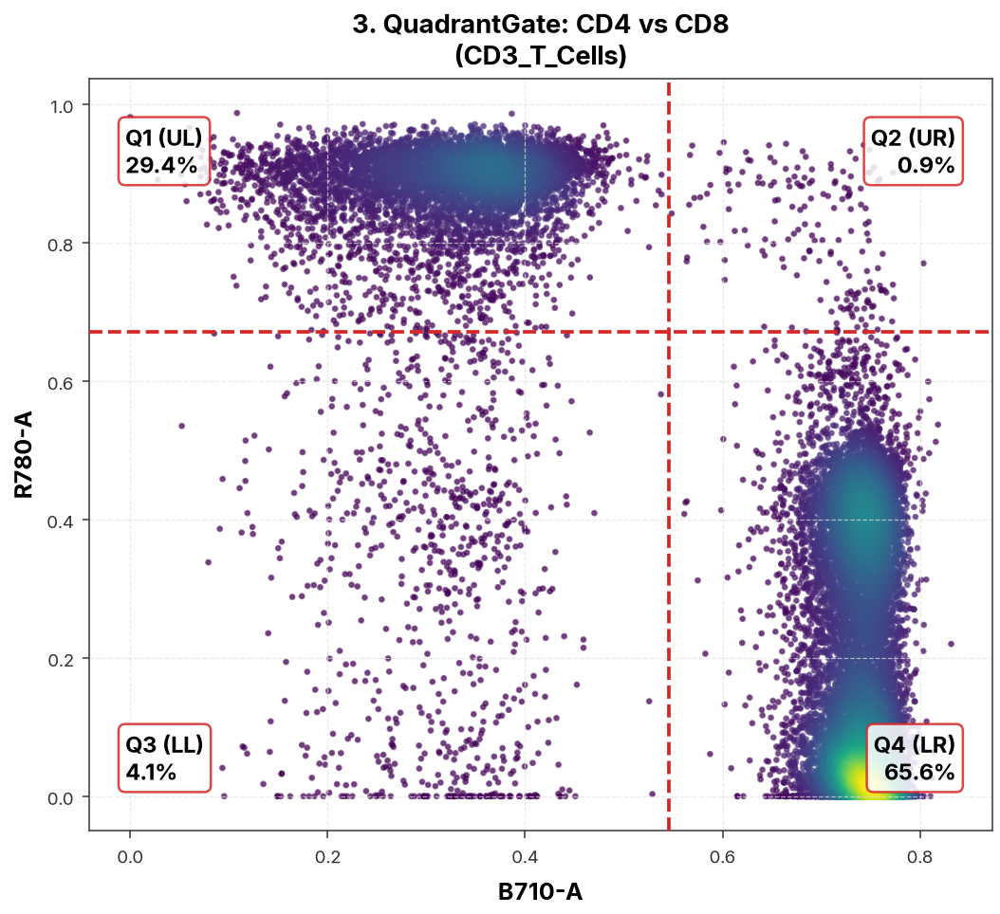

# 11. Build Manual & Hierarchical Gating Trees in Python

If you prefer traditional sequential gating (`Scatter` $\to$ `Singlets` $\to$ `Lineage` $\to$ `Quadrants`)—or want to combine FlowX's automated preprocessing (`time-qc`, `compensate`/`unmix`, `transform`) with custom gate geometries—build a `GatingHierarchy` directly using FlowX's gate primitives (`flowx.gating.gate`).

---

## 1. Gate Primitives & Coordinate Spaces

| Gate Class (`flowx.gating.gate`) | Dimensionality | Typical Use & Expected Space |
| :--- | :---: | :--- |
| `PolygonGate(name, channels, vertices, parent_gate=None)` | 2D | Arbitrary scatter (`FSC-A` vs `SSC-A`) or diagonal singlet polygons (linear scatter space, or transformed fluorescence space). |
| `RectangleGate(name, channels, x_min, x_max, y_min, y_max, parent_gate=None)` | 2D | Axis-aligned 2D marker boxes (transformed space). |
| `RangeGate(name, channel, min_val=None, max_val=None, parent_gate=None)` | 1D | Single-marker positivity/negativity cutoffs (e.g., `CD3+`, viability exclusion). |
| `QuadrantGate(name, channels, x_cutoff, y_cutoff, quadrant="all", parent_gate=None)` | 2D | Four-way splits: `Q1` ($X^-Y^+$), `Q2` ($X^+Y^+$), `Q3` ($X^-Y^-$), `Q4` ($X^+Y^-$), or `all`. |

> [!NOTE]
> `run_transformation_step()` keeps `FSC`/`SSC`/`Time` in linear space inside `transformed_df` while scaling fluorescence channels. For custom fluorescence gate names (other than `"Viable"` / `"Target"`), pass `transformed_df` directly to `hierarchy.evaluate(df_t)` so both scatter and fluorescence gates evaluate in their matching coordinate spaces.

---

## 2. End-to-End Manual Gating Example (`finak_2014_cytotrol_pbmc`)

```python
from flowx.io.parser import parse_fcs
from flowx.qc.runner import run_time_qc_step
from flowx.math.compensation import run_compensation_step
from flowx.math.transforms import TransformConfig, run_transformation_step
from flowx.gating.gate import GatingHierarchy, PolygonGate, RangeGate, QuadrantGate
from flowx.gating.density_gating import find_density_minimum, find_quadrant_cutoffs

# 1. Preprocess: Parse -> Time QC -> Compensation -> Arcsinh Transform
fcs = parse_fcs("data/conventional/finak_2014_cytotrol_pbmc/raw/samples/CytoTrol_CytoTrol_1.fcs")
tqc = run_time_qc_step(fcs, generate_plots=False)
comp = run_compensation_step(fcs, tqc.clean_df, compensation_source="embedded", generate_plots=False)
xf_cfg = TransformConfig(method="arcsinh", cofactor=150.0, normalized=True)
xf = run_transformation_step(
    fcs,
    comp.compensated_df,
    config=xf_cfg,
    generate_plot=False,
)
df_t = xf.transformed_df  # Linear scatter + normalized arcsinh fluorescence

# 2. Define parent scatter gate & compute parent-aware KDE valley cutoffs
cd3_ch = fcs.resolve_channel_name("CD3")
cd4_ch = fcs.resolve_channel_name("CD4")
cd8_ch = fcs.resolve_channel_name("CD8")

lymph_gate = PolygonGate(
    name="Lymphocytes",
    channels=["FSC-A", "SSC-A"],
    vertices=[[65000, 25000], [160000, 25000], [165000, 105000], [120000, 110000], [65000, 85000]],
    parent_gate=None,
)
lymph_mask = lymph_gate.apply(df_t)

cd3_cut = find_density_minimum(df_t.loc[lymph_mask, cd3_ch].to_numpy(), channel_name=cd3_ch).cutoff
cd3_gate = RangeGate(name="CD3_T_Cells", channel=cd3_ch, min_val=cd3_cut, parent_gate="Lymphocytes")
cd3_mask = lymph_mask & cd3_gate.apply(df_t)

qres = find_quadrant_cutoffs(df_t.loc[cd3_mask], x_channel=cd4_ch, y_channel=cd8_ch)

# 3. Assemble the hierarchical gating tree
hierarchy = GatingHierarchy()
hierarchy.add_gate(lymph_gate)
hierarchy.add_gate(cd3_gate)
hierarchy.add_gate(QuadrantGate(
    name="CD4_SP",
    channels=[cd4_ch, cd8_ch],
    x_cutoff=qres.x_cutoff,
    y_cutoff=qres.y_cutoff,
    quadrant="Q4",   # X+ (CD4+) Y- (CD8-)
    parent_gate="CD3_T_Cells",
))
hierarchy.add_gate(QuadrantGate(
    name="CD8_SP",
    channels=[cd4_ch, cd8_ch],
    x_cutoff=qres.x_cutoff,
    y_cutoff=qres.y_cutoff,
    quadrant="Q1",   # X- (CD4-) Y+ (CD8+)
    parent_gate="CD3_T_Cells",
))

# 4. Evaluate parent-child masks & compute hierarchy statistics
masks = hierarchy.evaluate(df_t)
stats = hierarchy.get_population_statistics(df_t, masks=masks)
print(stats[["Gate", "Parent", "Count", "% Parent", "% Total"]].to_string(index=False))
```

**Observed Output (`CytoTrol_CytoTrol_1.fcs`):**
```text
       Gate      Parent  Count  % Parent  % Total
       root        None 107555    100.00   100.00
Lymphocytes        root  56062     52.12    52.12
CD3_T_Cells Lymphocytes  43142     76.95    40.11
     CD4_SP CD3_T_Cells  28293     65.58    26.31
     CD8_SP CD3_T_Cells  12675     29.38    11.78
```

### Visualize the Manual Gating Cascade (`flowx.visualization.plotting`)

Use FlowX's built-in `plot_gate_overlay()`, `plot_histogram_1d()`, and `plot_quadrant_gate()` helpers to inspect every gate boundary:

```python
import matplotlib.pyplot as plt
from flowx.visualization.plotting import plot_gate_overlay, plot_histogram_1d, plot_quadrant_gate

# Panels 1 & 2: Lymphocytes PolygonGate + 1D CD3 RangeGate
fig, axes = plt.subplots(1, 2, figsize=(11, 4.5), dpi=180)
plot_gate_overlay(
    df_t, lymph_gate,
    x_label="FSC-A", y_label="SSC-A",
    title="1. PolygonGate: Lymphocytes",
    ax=axes[0],
)
plot_histogram_1d(
    df_t.loc[masks["Lymphocytes"]],
    channel=cd3_ch,
    channel_label="CD3 (Arcsinh)",
    cutoff=cd3_cut,
    cutoff_label=f"CD3 Cutoff ({cd3_cut:.2f})",
    title="2. RangeGate: CD3_T_Cells",
    ax=axes[1],
)
fig.savefig("manual_gating_step1_2.png", dpi=180, bbox_inches="tight")

# Panel 3: CD4 vs CD8 QuadrantGate on CD3_T_Cells
fig_q = plot_quadrant_gate(
    df_t.loc[masks["CD3_T_Cells"]],
    x_channel=cd4_ch,
    y_channel=cd8_ch,
    x_cutoff=qres.x_cutoff,
    y_cutoff=qres.y_cutoff,
    title="3. QuadrantGate: CD4 vs CD8 (CD3_T_Cells)",
    output_path="manual_gating_quadrant.png",
    dpi=180,
)
```





### FMO-Calibrated Thresholds (`calibrate_fmo_thresholds`)
When Fluorescence Minus One (FMO) controls are available, replace manual or KDE cutoffs with `calibrate_fmo_thresholds()` from `flowx.gating.fmo` (configured via `FMOCalibrationConfig`) to place positivity gates at a chosen false-positive quantile above the FMO negative tail.

---

## 3. Plug Into `FlowCytometryPipeline` & Export Workspaces

You can run a manual hierarchy inside the full pipeline (`gating_mode="template"`) or persist it as a `WorkspaceSession` for `flowx replay` and Gating-ML 2.0 XML export:

```python
from flowx.pipeline import FlowCytometryPipeline
from flowx.workspace.session import WorkspaceSession
from flowx.workspace.gating_ml_export import export_gating_ml

# Option A: Execute end-to-end pipeline matching your transform & template hierarchy
pipeline = FlowCytometryPipeline(
    output_dir="outputs/manual_pbmc",
    gating_mode="template",
    custom_hierarchy=hierarchy,
    transform_type="arcsinh",
    transform_cofactor=150.0,
    transform_config=xf_cfg,
    enable_cleanup_gating=False,
    overwrite=True,
)
result = pipeline.run("data/conventional/finak_2014_cytotrol_pbmc/raw/samples/CytoTrol_CytoTrol_1.fcs")

# Option B: Save, replay, and export standalone workspaces (include compensation & transforms)
xform_dict = {ch: xf.transform.to_dict() for ch in xf.channels_transformed}
session = WorkspaceSession(
    name="PBMC_Manual_Template",
    sample_path="data/conventional/finak_2014_cytotrol_pbmc/raw/samples/CytoTrol_CytoTrol_1.fcs",
    compensation=comp.comp_matrix,
    transforms=xform_dict,
    hierarchy=hierarchy,
)
session.save_json("outputs/manual_pbmc/workspace.json")
export_gating_ml(
    hierarchy,
    "outputs/manual_pbmc/manual_gating_ml_2.0.xml",
    compensation=comp.comp_matrix,
    transforms=xform_dict,
)
```

> [!TIP]
> Always pass matching `compensation` and `transforms` when saving a standalone `WorkspaceSession` (and prefer `save_json()` when your hierarchy contains `QuadrantGate`s). Note that standalone `flowx replay` replays on raw events without Time QC unless Time-QC-cleaned FCS/session is supplied, whereas `FlowCytometryPipeline` runs Time QC automatically (`107,555` vs `119,531` raw events).

Once saved to `workspace.json`, replay it across new samples via CLI or YAML (`analysis.workspace_file`):
```bash
flowx replay outputs/manual_pbmc/workspace.json --fcs-file path/to/new_sample.fcs
```

---

## References & Scientific Standards

* **Gating-ML 2.0 Standard:** [](doi:10.1002/cyto.a.22690)
* **FlowKit Computational Toolkit:** [](doi:10.3389/fimmu.2021.768541)
* **MIFlowCyt Standard:** [](doi:10.1002/cyto.a.20623)
